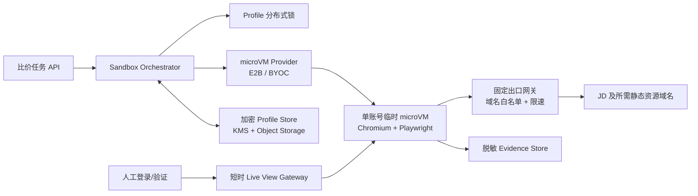

# 比价浏览器沙盒隔离设计

状态：独立子项目和 E2B Desktop Runner 已建立；加密 Profile Repository 与生产出口待接入

## 1. 结论

当前 `artifacts/price-crawler/profile-jd` 只是宿主机上的独立 Chromium Profile。它能保存登录态，
但不能隔离浏览器进程、文件、网络、内存或宿主机凭据，不能作为生产沙盒。

目标方案采用以下边界：

- 每次任务从不含账号数据的不可变模板启动一个临时 microVM。
- 一个 microVM 在整个生命周期内只能装载一个站点的一个账号 Profile。
- 完整 Chromium 用户目录按 `site/account_id` 加密、版本化保存；同一 Profile 只允许一个写任务。
- 任务结束先正常关闭 Chromium，再导出 Profile，最后无条件销毁 microVM。
- VNC/Live View 默认关闭，仅人工登录或验证时按需开放 10 分钟，使用一次性令牌并记录审计事件。
- 每个账号使用固定地区和稳定出口；出现 403 时熔断冷却，不切换 IP、不绕过验证码。

第一阶段使用 E2B 托管 microVM 验证业务。只有当国内固定出口、数据驻留或延迟无法满足要求时，
才迁移到 E2B BYOC。直接自建 Firecracker 作为第三阶段选项，而不是当前 MVP。

## 2. 目标架构



控制面不接触页面 DOM，任务代码不接触 KMS 主密钥。Profile 解密与加密由控制面的 Profile Gateway
完成，microVM 中只在任务存活期间出现明文浏览器状态。

## 3. 数据边界

| 数据 | 存放位置 | 生命周期 | 禁止事项 |
| --- | --- | --- | --- |
| 干净模板 | Provider 模板仓库 | 版本化 | 不得包含 Cookie、二维码、账号或密码 |
| 浏览器 Profile | 加密对象存储 | 按账号 TTL 和版本策略 | 不得跨账号共享，不得并发写 |
| 任务临时文件 | microVM 临时盘 | 单次任务 | 不得挂载宿主目录 |
| 抓取证据 | 独立 Evidence Store | 业务留存期 | URL 参数、Cookie、Token 必须脱敏 |
| Live View | 短时网关 | 最长 10 分钟 | 不暴露固定公网 VNC/envd 端口 |
| API/数据库凭据 | 控制面 Secret Gateway | 按请求 | 不写入模板、Profile、命令行或日志 |

完整 Profile 比单独 Cookie 更可靠，因为现代站点还可能依赖 localStorage、IndexedDB、Service Worker
和浏览器安全状态。导出前必须关闭 Chromium，避免 Cookie/Storage 的 SQLite 文件处于未提交状态。

## 4. 任务生命周期

1. API 只接收业务参数和逻辑 `profile_id`，不接收 Cookie 或密码。
2. Orchestrator 获取 `browser-profile:{site}:{account_id}` 分布式租约；拿不到则排队，不并发启动。
3. 从固定版本的干净模板创建 microVM，应用 CPU、内存、磁盘、期限和网络策略。
4. Profile Gateway 校验版本与 SHA-256，将账号专属 Profile 恢复到 microVM 临时盘。
5. 先执行登录状态与页面健康检查，再执行搜索或详情采集。搜索候选仍必须进入详情页二次核验。
6. 403、登录失效、验证码或页面结构变化立即停止；写入明确状态，不继续高频重试。
7. 仅在登录态健康且任务显式允许时，正常关闭 Chromium、导出新 Profile，并以 compare-and-swap
   方式提交新版本；403、验证码或解析失败不得覆盖最后一个健康版本。
8. 无论成功、失败或超时，都销毁 microVM 并释放租约；孤儿实例由独立回收器兜底。

登录流程与普通任务使用同一条路径，只是在第 5 步签发一次性 Live View 地址。人工完成登录后，
系统检测已登录标记，关闭浏览器、提交 Profile 并销毁 microVM。密码和二维码均不落日志。

## 5. 隔离控制

### 5.1 microVM 与宿主机

- Provider 必须提供 microVM，而不是共享宿主内核的普通容器。
- 根文件系统来自只读模板；写层只用于当前任务。
- 禁止宿主路径挂载、Docker socket、KVM 设备和云元数据服务进入 guest。
- 控制接口使用加密传输和访问令牌；envd、调试端口、VNC 不直接暴露公网。
- 生产自建 Firecracker 必须使用 Jailer、默认 seccomp、唯一 UID/GID、netns、cgroup 和资源上限。
- 自建宿主机负责出口过滤；Firecracker 自身不提供 guest egress 防火墙。

### 5.2 网络

- 默认拒绝出站，只允许目标站点及实测所需 CDN 域名。
- 阻断 RFC1918、回环、链路本地地址和 `169.254.169.254` 等云元数据地址。
- `profile_id` 绑定固定地区和稳定出口，不因 403 自动换出口。
- 每账号使用令牌桶和指数冷却；连续 403 触发熔断，并进入人工检查队列。
- 域名白名单先在不含真实登录态的测试 microVM 中通过 HAR 补齐，再应用到真实账号。

当前 JD 测试中，命令行请求约 1.38 秒返回 200，而浏览器随后访问详情接口得到 403，说明主要问题是
站点风控链路，不是单纯 DNS/TCP/TLS 不通。沙盒隔离不会消除风控，需要稳定身份、低频调度和人工验证。

### 5.3 持久化与快照

- 模板只保存公共二进制、Chromium、Playwright 和 worker 代码。
- 默认只持久化加密浏览器 Profile，不保存任务内存和任意临时文件。
- 禁止从含登录态的快照一对多创建实例，否则会复制账号身份并破坏单写者约束。
- E2B pause/resume 仅用于一次任务内的短时人工介入；必须配置业务 TTL 和孤儿清理，不能依赖平台无限保留。
- Chromium、内核或模板升级时创建新模板版本，旧 Profile 先做小流量兼容性验证。

### 5.4 人工接管

- 默认不开 VNC；需要登录、2FA 或平台验证时才启动 Live View。
- Live View 地址使用绑定用户、沙盒和用途的一次性令牌，10 分钟失效，用后立即撤销。
- 使用 `1024x768x24`，避免 1080p VNC 编码占用 2 vCPU 并放大跨区延迟。
- 自动阶段仍运行同一个 headed Chromium/Xvfb，但关闭 x11vnc/websockify；不尝试运行时切换 headless。
- 录像默认关闭；若为审计开启，需遮蔽账号敏感区域并设置短留存期。

## 6. Provider 选择

| 方案 | 当前建议 | 适用条件 | 主要风险 |
| --- | --- | --- | --- |
| E2B Managed | 首选验证 | 快速验证隔离和生命周期 | 中国固定出口、数据驻留、跨区 Live View 延迟 |
| E2B BYOC | 生产优先备选 | 需要自有 VPC、出口和日志边界 | 云资源与平台运维成本 |
| 自建 E2B infra/Firecracker | 第三阶段 | 必须完全自管且已有 KVM/安全运维能力 | Jailer、网络、快照、补丁、容量和故障恢复均需自负 |
| 普通 Docker | 不用于真实账号 | 本地无账号单元测试 | 共享宿主内核，隔离边界不足 |

自建前必须通过：裸机或明确支持嵌套虚拟化的 AMD64 主机、受支持内核、`/dev/kvm`、补丁策略、
独立安全评审、压力测试和灾难恢复演练。现有 PDF 中提到的 CentOS 7/内核 3.10 与部分云主机嵌套
虚拟化限制，不适合作为该生产底座。

### 6.1 日常 Chrome 当前页采集

对于“自动化浏览器被频控、用户的日常 Chrome 可以正常展示搜索结果”的场景，Parity 另外提供
用户辅助的当前页采集通道。这条通道不是 microVM 沙盒，也不复制用户 Profile：用户亲自完成登录、
搜索和必要的页面滚动，Chrome 扩展仅在用户点击时取得当前标签页的临时权限并提取可见商品字段。

扩展没有京东域名的常驻 `host_permissions`，不能在后台遍历京东页面；它只允许向
`http://127.0.0.1/*` 发送数据。本机 Bridge 只监听回环地址，并同时校验 Chrome 扩展来源、随机配对
令牌、请求大小、京东域名和字段白名单。Cookie、密码、localStorage、完整 HTML、浏览历史及扩展未识别
字段均不进入持久化结果。该通道产生的结构化 JSON 后续可以作为 Agent 输入，但不能反向成为浏览器控制接口。

## 7. 独立子项目边界

`parity` 是已经从 `mojing_agent` 物理迁出的独立项目，不导入 Mojing、Agent、Kafka 或业务数据库代码。
站点 collector 也归属本子项目。它只负责 microVM 生命周期、浏览器状态、人工接管、网络策略和采集任务执行。未来 Agent 通过受认证的
HTTP/gRPC API 提交任务，只接收结构化结果和证据引用，不能拿到 Profile 文件、Cookie 或 provider 句柄。

## 8. 已落地的最小骨架

- `config/sandbox-policy.example.toml`：默认拒绝弱隔离配置。
- `src/parity/policy.py`：可执行策略校验器，容器、公开控制端口、开放出口、Profile 并发写等配置会被拒绝。
- `src/parity/lifecycle.py`：Provider 无关的生命周期编排；先锁 Profile、从干净模板创建、恢复状态、关闭浏览器、
  原子写回，并在 `finally` 中销毁实例。
- `src/parity/e2b_runner.py`：使用官方 `desktop` 模板创建真实 E2B microVM，在 VM 内安装 Playwright 驱动并复用
  系统 Chrome，上传 collector、取回 JSON/截图并销毁实例。本阶段允许互联网用于可读性验证；生产
  上线前必须由 BYOC/出口网关落实域名白名单。
- `tests/test_isolation.py`：验证不安全策略、并发写入和异常清理。

校验命令：

```text
python -m parity.policy config/sandbox-policy.example.toml
```

这个骨架不会伪装成已经连接了云端 Provider。下一步需要实现 `SandboxProvider` 和
`ProfileRepository`：前者对接 E2B/BYOC，后者对接 Redis/PostgreSQL 租约、KMS 与对象存储。

## 9. 上线验收门槛

- 两个不同账号同时运行时，无法读取彼此 Profile、临时文件、进程、端口和证据。
- 同一 Profile 的第二个写任务被排队或拒绝。
- 任务异常、超时和 worker 崩溃后，microVM 在回收期限内消失。
- guest 无法访问内网、宿主机、云元数据和未授权域名。
- 日志、截图、HAR 和异常信息中没有 Cookie、Token、密码或完整敏感查询参数。
- Live View 过期后无法复用，所有接管动作可关联到操作者和任务。
- 403 触发熔断，不发生自动代理轮换、验证码绕过或无上限重试。
- 升级模板后，旧 Profile 可回滚到最近三个加密版本。

## 10. 参考资料

- E2B：[Sandbox persistence](https://e2b.dev/docs/sandbox/persistence)、
  [snapshots](https://e2b.dev/docs/sandbox/snapshots)、
  [secured access](https://e2b.dev/docs/sandbox/secured-access)、
  [BYOC](https://e2b.dev/docs/byoc) 和
  [2026 infra releases](https://github.com/e2b-dev/infra/releases)。
- Firecracker：[Production Host Setup](https://github.com/firecracker-microvm/firecracker/blob/main/docs/prod-host-setup.md)、
  [Jailer](https://github.com/firecracker-microvm/firecracker/blob/main/docs/jailer.md)、
  [snapshot support](https://github.com/firecracker-microvm/firecracker/blob/main/docs/snapshotting/snapshot-support.md)
  和 [snapshot versioning](https://github.com/firecracker-microvm/firecracker/blob/main/docs/snapshotting/versioning.md)。
- Browserbase：[Contexts](https://docs.browserbase.com/platform/browser/core-features/contexts)、
  [website authentication](https://docs.browserbase.com/platform/identity/authentication) 和
  [Live View](https://docs.browserbase.com/platform/browser/observability/session-live-view) 的账号状态实践。
- Daytona：[Network Firewall](https://www.daytona.io/docs/en/network-limits/)、
  [Secrets](https://www.daytona.io/docs/en/secrets/)、
  [Volumes](https://www.daytona.io/docs/en/volumes/) 和
  [VM snapshots](https://www.daytona.io/docs/snapshots/) 的控制面实践。
- 项目资料：`Firecracker 自建沙盒.pdf`、`e2b 延迟.pdf`、`Tiktok-sandbox.pdf`、
  `进阶沙盒 - 小红书版本.pdf`、`个性化沙盒会是每个人的第三只手.pdf`。
